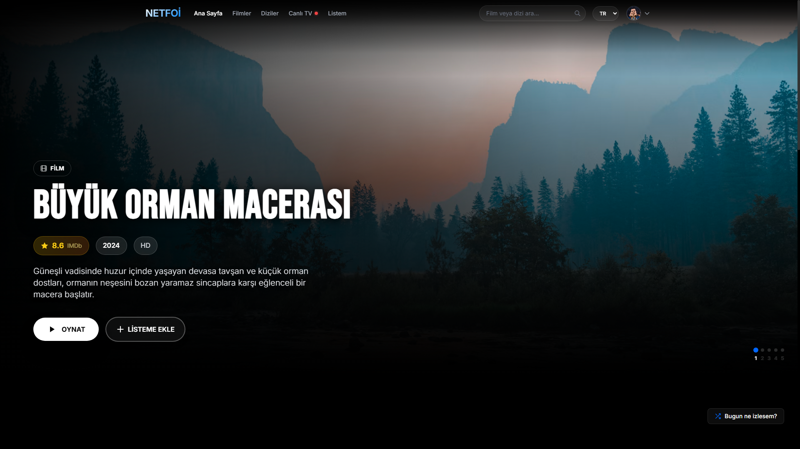
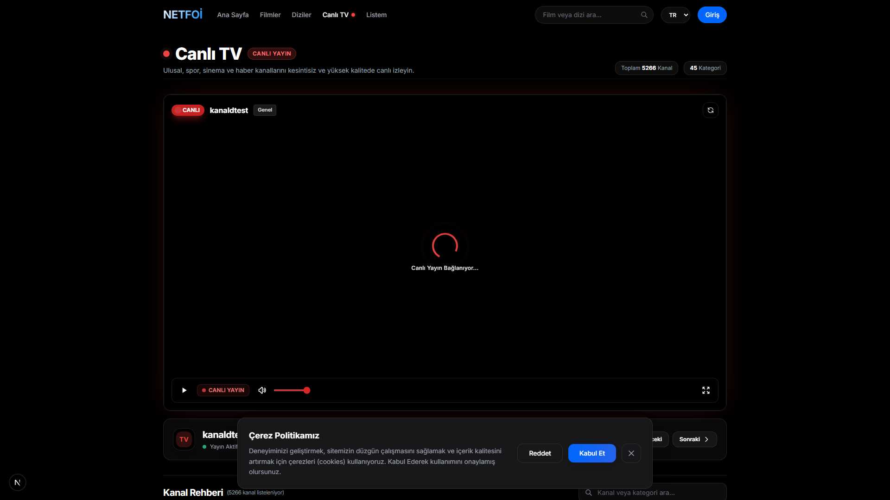
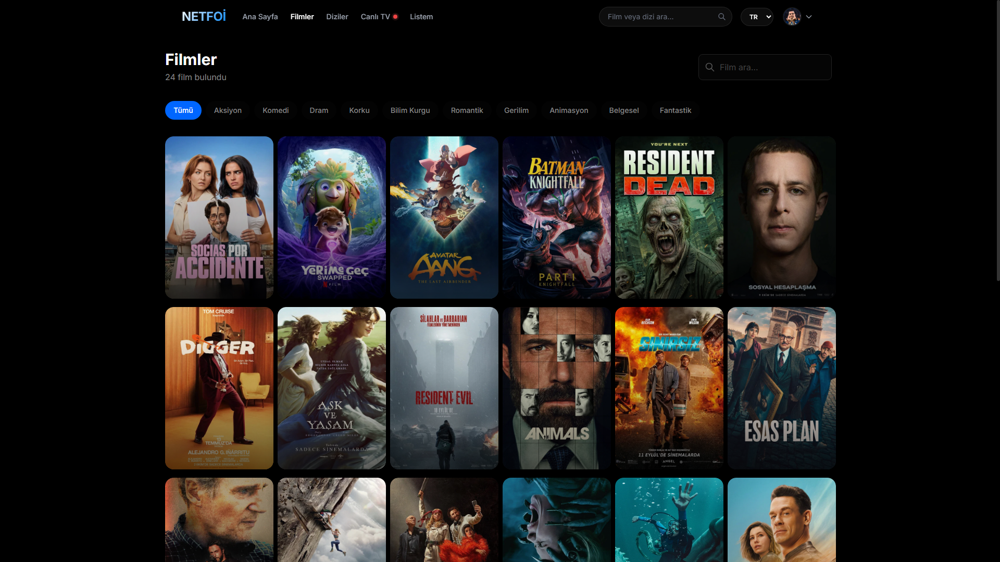
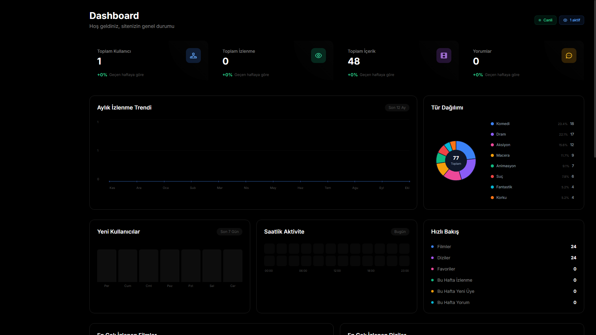
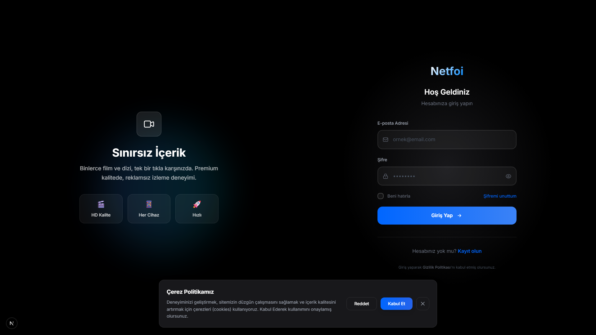
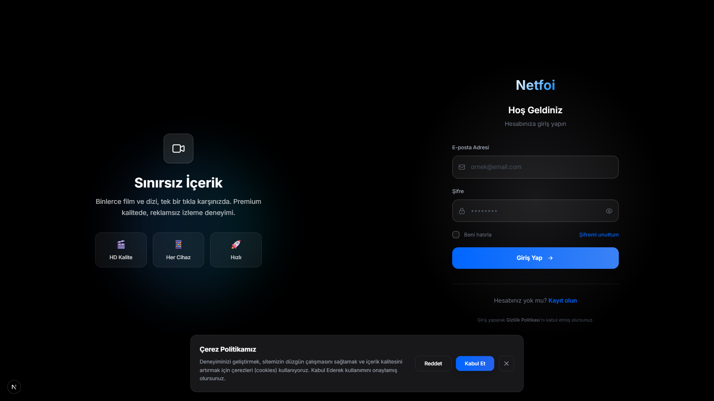
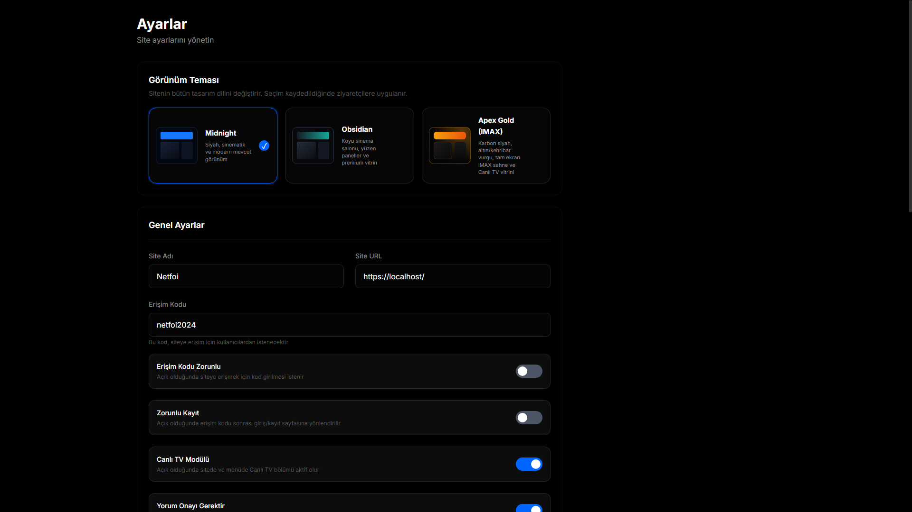
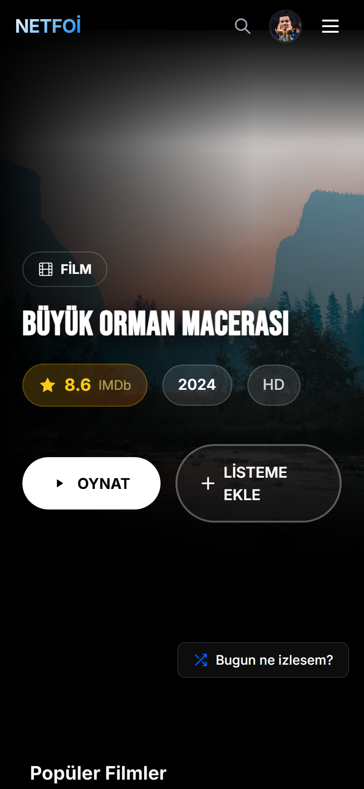
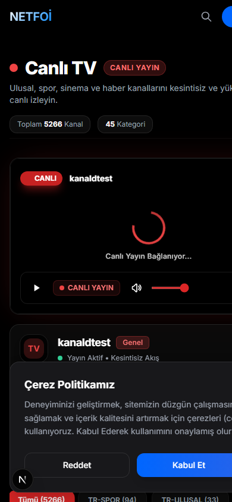
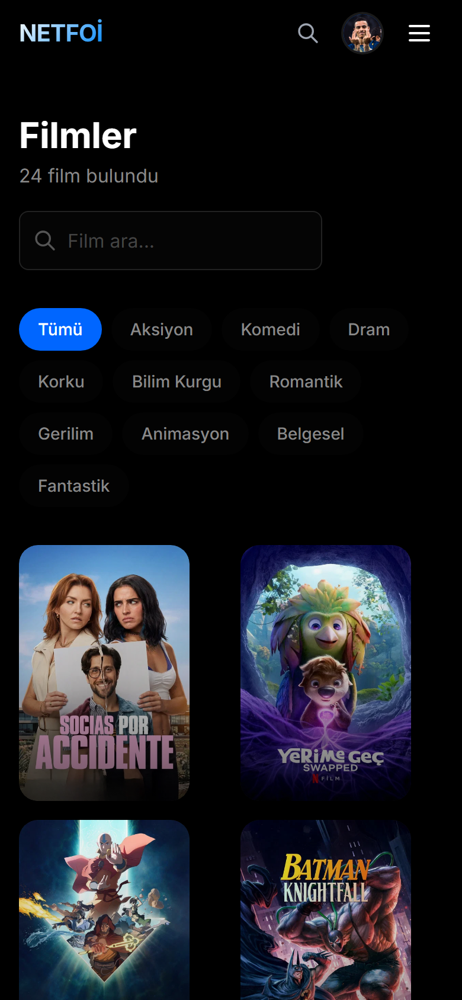

🌐 <a href="README.md">Türkçe</a> · <b>English</b>

  

# Netfoi — Movie, Series & Live TV (IPTV) Streaming Script

**Next-generation cinematic VOD & Live IPTV streaming platform.** Complete turnkey solution featuring movie & series databases, multi-theme engine, and a proprietary **CORS-Free Xtream Codes IPTV streaming proxy**.

Next.js 16 · React 19 · TypeScript · Tailwind CSS · Prisma ORM · HLS.js

 

&nbsp;

&nbsp;

  

 

> [!IMPORTANT]
> **📢 Commercial License & Inquiries:** Contact via Telegram: [@jzlvv](https://t.me/jzlvv) or GitHub profile.
>
> 🔒 **Showcase Notice:** Source code and technical binaries are proprietary. This repository serves exclusively as a visual showcase and feature presentation.

---

## 📸 Screenshots

| 🎬 88vh IMAX Home Stage | 📺 Live TV & IPTV Player |
|---|---|
|  |  |

| 🍿 Movies & Series Catalog | ⚙️ Admin Dashboard |
|---|---|
|  |  |

| 📡 Live Channel Management | ⚡ Bulk Channel Import Wizard |
|---|---|
|  |  |

  
   
  <em>Settings: Instant one-click toggle between Midnight (Blue), Obsidian (Teal), and Apex Gold (IMAX Gold)</em>

### 📱 Mobile View (Responsive PWA)

  
  &nbsp;&nbsp;
  
  &nbsp;&nbsp;
  

---

## ⭐ Key Highlights

- 📺 **Xtream Codes IPTV Proxy**: Server-side 302 token redirect & Cloudflare bypass with automatic `.m3u8` playlist segment rewriting for 100% browser playback.
- ⚡ **Bulk Channel Importer**: Paste tab-delimited channel lists (`CATEGORY\tNAME\tURL`) and import 5,000+ channels with real-time interactive table preview in seconds.
- 🎬 **Full-Featured Media Player**: Custom HLS low-latency player, multi-audio selection, stream reconnect recovery, and quality toggles.
- 🎨 **3x Built-in Themes**: Midnight (Dark Blue), Obsidian (Dark Teal), Apex Gold (IMAX Cinema Gold).
- 🤖 **TMDB API Automation**: One-click poster, backdrop, synopsis, cast, and rating scraping.
- 🔒 **Access Code Protection**: Private community mode requiring an access code before entering.
- 📱 **Progressive Web App (PWA)**: Add to home screen and standalone app experience on mobile devices.

---

## 💼 Inquiries & Purchase
- ✈️ **Telegram:** [@jzlvv](https://t.me/jzlvv) *(Direct & Fast Response)*
- 💬 **GitHub:** [@39Baris](https://github.com/39Baris)

## 📄 License
Commercial Proprietary Software — **All Rights Reserved**.
